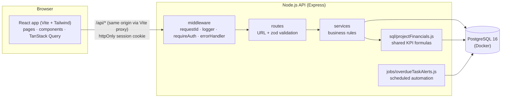

# Architecture & design decisions

## Layers
| Layer | Folder | Responsibility |
|---|---|---|
| UI | `client/src/pages`, `components` | Screens, forms, tables, charts. No business maths. |
| API client | `client/src/api` | `apiFetch()` + one function per endpoint |
| Data fetching | `client/src/hooks/useApiMutation.js` | Save → refetch affected data from the server → toast |
| Routes | `server/src/routes` | HTTP methods, status codes, input validation (zod) |
| Services | `server/src/services` | Rules: permissions, workflow transitions, finance, audit |
| Data access | `server/src/db.js` | `query()` (parameterized) and `withTransaction()` |
| Database | `server/db/migrations` | Tables, constraints, triggers, indexes |

## A request end to end (example: PM posts a cost)
1. **Browser** – `CostFormModal` validates the form, asks for confirmation, then calls `financeApi.createCost()` with a one-time `Idempotency-Key`.
2. **Vite proxy** forwards `/api/projects/2/costs` to Express (same origin → the httpOnly cookie is sent).
3. **requestId** gives the request an ID; **requestLogger** will log it; **requireAuth** verifies the JWT cookie and reloads the user.
4. **financeRoutes** validates the body with zod (amount > 0, 2 decimals, valid date…).
5. **financeService.createCost** checks the user may manage the project (owner PM or admin), checks the date, checks the idempotency key, then in **one transaction** inserts the cost and its audit event.
6. **PostgreSQL** enforces constraints (amount > 0, posted cost has `posted_by`).
7. The browser's `useApiMutation` invalidates `finance`, `costs`, `project`, `dashboard` → those screens **refetch from the server**, so Actual spend and the dashboard update without any client-side calculation.

## Key decisions and trade-offs
| Decision | Why | Trade-off |
|---|---|---|
| `pg` + hand-written SQL migrations instead of an ORM | SQL is visible and explainable; complex KPI queries are plain SQL; every query could be tested against real Postgres during development | More boilerplate for simple CRUD |
| Business rules in services **and** key rules in the database (CHECK, triggers, UNIQUE) | Defence in depth: even a buggy endpoint or manual SQL cannot post-then-delete a cost or self-approve | Some rules exist in two places |
| JWT in an httpOnly, SameSite=Lax cookie | Token is not readable by JavaScript (XSS), not sent cross-site (CSRF) | Needs same-origin hosting (solved with the Vite proxy / one domain in production) |
| User reloaded from DB on every request | Role change or deactivation applies immediately | One small extra query per request |
| Optimistic locking (`version` column) | Two people editing the same record → the second gets a clear 409 instead of silently overwriting | User must reload and redo their change |
| Idempotency key on cost creation + `WHERE status='DRAFT'` on posting | Double clicks / retries cannot create or post twice | Client must generate a key per form |
| `SELECT … FOR UPDATE` on change-request decisions | Two approvers clicking at once are serialised | Row is locked for the length of the transaction (milliseconds) |
| Fixed reporting date in config | Repeatable demo numbers | Production would switch to `CURRENT_DATE` |
| Dashboard KPIs computed per table inside a project "scope" | Filters apply consistently; no join fan-out inflation | Several small queries instead of one (run in parallel) |
| Automation as an in-process timer | No extra infrastructure for a local demo | In production: a separate worker/cron so it doesn't run once per API instance (the unique `event_key` already makes parallel runs safe) |

## Concurrency scenario (Section 3.5)
1. Priya and an admin open the same task (`version = 3`).
2. Priya saves → `UPDATE … WHERE id = $1 AND version = 3` succeeds, version becomes 4.
3. The admin saves → `WHERE version = 3` matches no row → API returns **409 "This record was changed by someone else… reload"**.
Covered by the smoke test "Stale version -> 409". Change-request decisions also check `version` and lock the row (`FOR UPDATE`).

## Transaction integrity (Section 3.2)
`withTransaction()` wraps `BEGIN … COMMIT` and rolls back on any error. Used for:
- change-request decision + history row + audit event
- cost creation/posting + audit event
- budget-revision decision + audit event
- project create (project + code + members + audit)
- each automation attempt (all alerts of an attempt or none)
- the CSV import and each migration file

If any statement fails (constraint, trigger, crash), nothing from that operation is saved - there is no state where a decision exists without its history row.

## Logging & error handling
- Every request gets an **X-Request-Id** (returned in the response header and in every error body).
- `server/logs/app.log` - one JSON line per request (method, path, status, duration, user, request ID) and per automation run; 500s include the stack trace.
- Every error response has one shape: `{ error: { code, message, details, requestId } }`; the UI shows the message and the request ID in a toast, so a reported problem can be found in the log.
