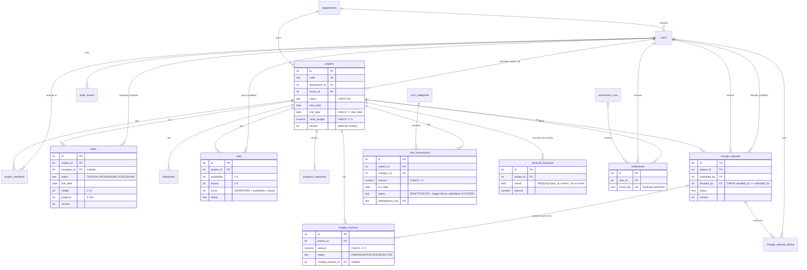

# Database design (ER diagram)

PostgreSQL 16. Schema: `server/db/migrations/001_init.sql` (17 tables, created by `npm run db:migrate`).
The diagram renders on GitHub (Mermaid).

## Cardinalities in words
- A **department** has many users and many projects. A **project** belongs to one department and has one owner (a project manager).
- **project_members** is the many-to-many link between users and projects; it drives scoped access (a user only sees projects they belong to). The owner is always also a member.
- A project has many **tasks, milestones, risks, change requests, budget revisions, cost transactions, forecasts, progress snapshots**.
- A task / risk *may* have no assignee / owner (nullable foreign key) - e.g. the seeded unassigned task.
- A change request has many **history** rows (one per status change). A budget revision *may* point to one approved change request - the link is explicit, never automatic.
- **financial_forecasts** has at most one row per project per month (`UNIQUE (project_id, month)`), so saving a forecast is an upsert.

## The risk of joining several one-to-many tables
`projects → cost_transactions` and `projects → budget_revisions` are both one-to-many. Joining both in one query
returns *(number of costs × number of revisions)* rows per project, so `SUM(amount)` counts each cost once per revision.
Example: PRJ-002 has 16 posted costs (to 30 Sep) and 1 approved revision - fine; with 3 revisions every cost would be counted 3 times.
**Rule used everywhere:** aggregate each one-to-many table to one row per project in its own sub-query, then join
(`server/src/sql/projectFinancials.js`, `docs/sql/report-queries.sql` query 2). The dashboard goes further and computes each KPI
from a single table restricted to the filtered project ids.

## Indexes (chosen for filtering and joins)
| Index | Used by |
|---|---|
| `projects(department_id)`, `projects(owner_id)`, `projects(status)` | portfolio filters, dashboard scope |
| `project_members(user_id)` | "projects I can see" check on every request |
| `tasks(project_id, status)`, `tasks(assignee_id)`, `tasks(due_date)` | task lists, overdue counts |
| `milestones(project_id, due_date)` | roadmap, due-soon |
| `risks(project_id, status)` | open/high-exposure risks |
| `change_requests(project_id, status)` | approval queue |
| `cost_transactions(project_id, txn_date)`, `cost_transactions(category_id)` | actual spend to a date, spend by category |
| `audit_events(entity_type, entity_id)`, `audit_events(created_at)` | audit log |
| `notifications(user_id, is_read)` | unread badge |

## Rules enforced by the database itself
- **CHECK constraints:** allowed status values; amounts > 0; progress 0–100; probability/impact 1–5; end ≥ start; `decided_by <> submitted_by` (no self-approval, also for budget revisions); a DONE task must be 100% with a completion date; a POSTED cost must have `posted_by`/`posted_at`.
- **Triggers:** posted cost transactions cannot be updated or deleted; `change_request_history` and `audit_events` are append-only.
- **UNIQUE:** project code, user email, `idempotency_key` (no double-posted cost), `event_key` (no duplicate alert), one forecast per project-month.
